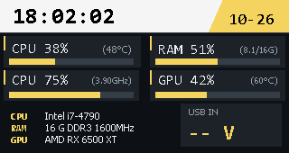
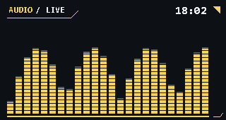

# Hub PC Monitor

带屏幕 USB Hub 的独立 Windows 上位机，当前版本 **v0.5.4**。

已实测佳点 V1PRO / V1P（320×170），预留 V2（320×240）布局。无需让厂商上位机保持运行；使用时请先退出其他占用设备的控制程序。

## 功能

- 性能监控：CPU 占用与温度、RAM 使用、CPU 频率区间百分比及 GHz、GPU 占用及温度、配置与输入电压。
- 默认时钟、DeepSeek 时钟、ChatGPT 时钟＋可选额度查询。
- BongoCat 画面映射：后台捕获、变化区域发送、可选精度优化；需自行安装 BongoCat。
- 音乐律动：默认播放设备回环采集，24 段频谱，无需麦克风。
- 屏幕旋转、断线重连、托盘运行、可选登录自启与温度采集服务。

## 主题预览

| 性能监控 | DeepSeek 时钟 | 音乐律动 |
| --- | --- | --- |
|  |  |  |

预览由实际主题绘制代码生成；指标和频谱为示例，实际显示随电脑状态变化。

## 普通用户

在仓库的 **Releases** 页面下载发布压缩包（有发布时），解压运行安装程序。详细安装和使用说明见 [使用说明](independent-clock/packaging/release-README.md)。

需要 Windows 10/11 x64、Windows PowerShell 5.1、.NET Framework 4.8，以及正确安装的设备 USB 驱动。V2 尚未完成实机验证，实际 FPS 取决于 USB 传输、固件和画面变化量。

## 开发与构建

使用 Windows PowerShell，在仓库根目录运行：

```powershell
# 绘制、协议数据处理和采样算法自检；不写入 Hub
powershell.exe -NoProfile -ExecutionPolicy Bypass -File .\independent-clock\clock.ps1 -SelfTest

# 从源码启动主界面
powershell.exe -NoProfile -ExecutionPolicy Bypass -STA -File .\independent-clock\clock.ps1

# 生成安装包：dist/HubPcMonitor-Setup.exe
powershell.exe -NoProfile -ExecutionPolicy Bypass -File .\independent-clock\packaging\build.ps1

# 生成带说明、许可证和 SHA256 校验的分享压缩包
powershell.exe -NoProfile -ExecutionPolicy Bypass -File .\independent-clock\packaging\package-release.ps1
```

`-SelfTest` 会生成本地预览图，这些文件不会进入版本控制。启动软件会访问连接的 Hub；温度组件只有在安装时选择后才会请求管理员权限。

首次连接无法报告型号的旧固件时，在软件弹窗中按实际型号选择。软件在本机生成 `device-profiles.json`；不要提交这份序列号记录。设备型号示例见 [device-profiles.example.json](independent-clock/device-profiles.example.json)。

## 目录

| 路径 | 用途 |
| --- | --- |
| `independent-clock/clock.ps1` | 桌面界面、主题绘制和运行流程 |
| `independent-clock/UsbClock.cs` | USB 协议、区域刷新与重连相关实现 |
| `independent-clock/PerformanceSampler.cs` | CPU、内存、频率和 GPU 性能采样 |
| `independent-clock/AudioSpectrum.cs` | WASAPI 音频回环、FFT 与频谱绘制 |
| `independent-clock/BongoCapture.cs` | 外部 BongoCat 窗口捕获 |
| `independent-clock/cpu-frequency-profiles.json` | 已核实型号的基准/睿频及来源 |
| `independent-clock/packaging/` | 安装、卸载、构建与发布脚本 |
| `independent-clock/native/`、`sensors/` | 构建和运行所需第三方依赖及许可 |

## 更新方式

1. 修改源码并运行相应检查。
2. 更新 `independent-clock/version.json`、发布说明和更新记录中的版本号。
3. 执行 `package-release.ps1`，检查 `dist/` 的安装包与压缩包。
4. 提交代码、创建对应版本标签，再将压缩包和校验文件上传到 GitHub Releases。

正式发布目录已存在时，脚本会停止以避免覆盖已有版本；新版本使用新版本号。日志、本机配置、凭据、安装包、临时构建目录及厂商/BongoCat 程序不进入源码仓库。

## 依赖与数据

第三方组件见 [许可和来源说明](independent-clock/packaging/THIRD-PARTY-NOTICES.txt) 及 `sensors/licenses/`，文件摘要见 `independent-clock/dependencies.json`。BongoCat 本体和模型不随本仓库分发。

ChatGPT 额度查询默认关闭，仅从运行软件的电脑读取其已有 Codex 登录状态；仓库不包含账号信息。音乐采集不写音频文件、不上传音频。硬件、登录状态及数据是否可用取决于运行电脑。

CPU 频率卡片的 0% 对应该型号的基准频率，100% 对应最高睿频；它不是 CPU 占用率。当前只预置部分经核实型号，未收录的型号显示 `--%` 并保留 GHz。
